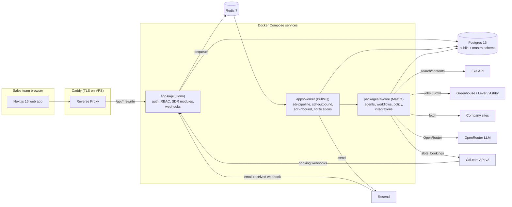

# Ledgerwise AI SDR Platform: Principal Architecture & Implementation Specification

**Status:** LOCKED · **Locked:** Fri 13 Nov 2026, 19:50 CET · **Hard deadline:** Sun 15 Nov, ~18:45 CET (48 h)

---

## 0. TL;DR & Locked Decisions

- **The starter fits well. Keep it.** Auth, multi-tenancy, RBAC, BullMQ, Mastra and Docker are all in place and work: typecheck passes in 6/6 packages and Ultracite is clean on 230 files. We add the SDR domain on top rather than rewriting the foundation.
- **Boot & deploy blockers resolved in M0:**
  - **F1:** Empty optional AI provider keys (`""` in `.env`) normalized to `undefined` in `apps/api/src/env.ts`.
  - **F2:** S3 credentials (`S3_ACCESS_KEY_ID`, `S3_SECRET_ACCESS_KEY`) made optional in production unless configuring object storage (validated as an all-or-nothing pair).
  - **F3:** Added `DISABLE_SIGNUP` env flag wired to Better Auth `emailAndPassword.disableSignUp` and `emailOTP.disableSignUp` so production demos rely on pre-seeded verified accounts.
- **Locked decisions (from Phase 0 review):**
  1. **Outbound email mode (Q1):** Default `OUTBOUND_MODE=sandbox` (all outbound emails redirect to `SANDBOX_RECIPIENT_EMAIL`) + in-app **Prospect Reply Simulator** in the Inbox (`POST /api/threads/:id/simulate-inbound`), with `OUTBOUND_MODE=live` supported behind environment configuration.
  2. **Hosting (Q2):** Self-hosted on a single VPS using Docker Compose (`docker-compose.prod.yml`) + Caddy for automatic TLS.
  3. **LLM Provider (Q3):** **OpenRouter** (`OPENROUTER_API_KEY`) via Mastra's `openrouter/<provider>/<model>` router (`SDR_MODEL_FAST` and `SDR_MODEL_SMART`).
  4. **Autopilot default (Q4):** `replies_auto` — confident replies that pass all deterministic and LLM guards auto-send; anything uncertain or triggered hands off to a human. **First emails always require human approval.**
  5. **AI disclosure policy (Q5):** Default `when_asked` — when a prospect asks if they are speaking with an AI/bot, the agent answers honestly and includes a clear disclosure (enforced by a deterministic output guard when `asks_if_bot = true`).
- **Locked refinements:**
  - **Qualification scoring for private company size:** Because private $1M–$10M e-commerce brands rarely publish revenue or exact headcount, when US + e-commerce gates pass and no large-company disqualifiers exist, `unknown` revenue and `unknown` employee band each score **10 / 15** (instead of 5 / 15) so strong timing leads can reach Tier A (≥70).
  - **First email style:** Conversational, **< 100 words**, grounded strictly in verified evidence and the Ledgerwise playbook, **without** a physical mailing address footer.
  - **Live simulator UX:** When a simulated prospect reply (or regeneration) is enqueued in BullMQ, the Inbox thread view automatically polls every 1.5s until the background run settles so the UI updates live without a manual page refresh.

---

## 1. Requirements Traceability

| # | Case requirement | Feature | Acceptance criterion (what "done" means) |
|---|---|---|---|
| R1 | Research ≥30 real ICP companies | Discovery + enrichment pipeline | ≥30 companies tiered A/B. Each has a verified website, US evidence, e-commerce evidence and ≥1 dated timing signal, all with sources |
| R2 | Qualify, show why with sources | Rubric scoring + score breakdown UI | Every criterion shows a verdict, a one-line rationale, and ≥1 source chip (link + quote) or an explicit "unknown" |
| R3 | Short personal email, facts only from research | Writer + fact-check + guards | <100 words, conversational, no physical address footer. Every prospect claim is mapped to a verified evidence row. 0 price mentions |
| R4 | Answer replies, handle objections, follow rules, hand off | Reply pipeline + policy router | Golden-set eval: opt-out recall 100%, price leaks 0, bot honesty 100%, action accuracy ≥90% |
| R5 | Offer real free slots, book in a calendar | Cal.com slots + booking tools | Slots come live from Cal.com. A booking creates a real Cal.com event plus a `meetings` row. No double-booking |
| U1 | See companies, score and reasons | `/dashboard/companies` list + detail | Sort/filter by score, tier, signal, status. Reasons have clickable sources |
| U2 | Review each email: approve / edit / reject | `/dashboard/review` queue | Keyboard-friendly one-at-a-time queue. Edits are diffed and re-guarded. Rejections capture a reason |
| U3 | Read every conversation, take over any thread | `/dashboard/inbox` | Every message shows who wrote it (AI, human, prospect) and why the AI acted. One-click Take over / Hand back + live-polling simulator |
| U4 | See booked calls | `/dashboard/meetings` | Upcoming and past calls, linked to company and thread |
| D1–D5 | Live URL (2 weeks), public repo, session exports, HOW_I_WORKED.md, Loom | §15, §16 | See deliverables checklist |

---

## 2. Phase 0 Repository Audit

### 2.1 Component Disposition

| Area | Today | Verdict | Action |
|---|---|---|---|
| Monorepo (Bun 1.3 + Turbo, catalogs, isolated linker) | Solid | **Keep** | — |
| `apps/api` Hono + Better Auth + org plugin + RBAC + tenant helpers (`withOrg`, `getActiveOrgContext`) + rate limiter + audit | Good conventions (route → service → db) | **Keep** | Add SDR modules using the same pattern as `modules/organization` |
| `apps/api` storage (S3/MinIO) | Not needed for SDR | **Hide** | Make S3 optional in prod env (F2). Remove from nav |
| `apps/api` `modules/ai` chat + workspace-brief | Starter demo | **Retire from UI** | Keep the runtime-cache pattern (`getAiRuntime`). Drop the chat route from nav |
| `apps/worker` BullMQ (email, notification) + Resend sender w/ idempotency | Good | **Keep + extend** | Add `sdr-pipeline`, `sdr-outbound`, `sdr-inbound` processors. Add `@workspace/ai-core` dependency |
| `packages/ai-core` Mastra runtime (`createMastraRuntime`), PostgresStore/PgVector in `mastra` schema, guardrail processors, observability | Good foundation | **Keep runtime, extend agents** | Add SDR agents, workflows, policy router, and integrations. Rebrand `serviceName` |
| `packages/db` Drizzle (`schemaFilter: public`), migrations, pgvector init, seed | Good | **Extend** | New `sdr.ts` schema file + migration + Ledgerwise seed (org, users, playbook) |
| `packages/ui` primitives (button, card, table, tabs, dialog, select, badge, sonner) + auth forms + notification center | Good base | **Extend** | Add Textarea, Switch, Tooltip, Popover, Sheet, ScrollArea, Skeleton, Separator |
| `apps/web` Next 16 App Router, server session guard, React Query, Hono RPC client | Good | **Re-skin** | New SDR IA (§10). Landing page becomes the Ledgerwise sign-in |
| Docker (3 multi-stage Dockerfiles), `docker-compose.yml` (pg16+pgvector, redis, minio), CI (lint, types, test, build) | Good | **Keep** | Add `docker-compose.prod.yml` + Caddy for the VPS deployment (§15) |
| Notifications (in-app/email/push) | Good | **Keep in-app** | Trigger in-app notifications on review ready, handoff needed, and meeting booked |

### 2.2 Verified Findings

| ID | Sev | Finding | Evidence | Fix |
|---|---|---|---|---|
| **F1** | 🔴 | **API won't boot with blank optional AI keys in `.env`.** `GOOGLE_GENERATIVE_AI_API_KEY=""` (and 3 others) fail `z.string().trim().min(1).optional()` | `bun run test` → 45 pass / 9 fail (`Invalid API environment variables` from `apps/api/src/env.ts`) | Transform empty/whitespace strings to `undefined` for optional keys. Add regression test (M0) |
| **F2** | 🟠 | Prod env **requires** `S3_ACCESS_KEY_ID` and `S3_SECRET_ACCESS_KEY` even though SDR doesn't use object storage | `requiredInProd` in `apps/api/src/env.ts` | Remove S3 keys from `requiredInProd`; require both only when either is provided (M0) |
| **F3** | 🟠 | Public sign-up is open by default | `lib/auth/index.ts` | Add `DISABLE_SIGNUP` env flag wired to `emailAndPassword.disableSignUp` and `emailOTP.disableSignUp` (M0) |
| **F4** | 🟠 | Outbound email safety | `apps/worker/src/env.ts` | Default `OUTBOUND_MODE=sandbox` routes all emails to `SANDBOX_RECIPIENT_EMAIL` |
| **F5** | 🟡 | Starter branding leftovers (`E2E AI Starter`, `e2e-ai-starter`) | `assistant-agent.ts:23`, `runtime.ts:135` | Rebrand to Ledgerwise AI SDR |
| **F6** | 🟡 | Worker needs `@workspace/ai-core` to execute SDR pipelines asynchronously | `apps/worker/package.json` | Add `@workspace/ai-core` dependency in M1 |
| **F7** | 🟡 | Webhooks (Resend inbound, Cal.com) need unauthenticated signature-verified routes | `app.ts` | Mount `/api/webhooks/*` outside `authMiddleware`, verify signatures, resolve tenant from thread token |

---

## 3. Architectural Choices

### 3.1 Agent Architecture: Deterministic Pipeline + Narrow Structured LLM Steps
Code performs fetching, quote verification, score summation, routing, and send-gating. LLMs perform extraction, per-criterion evaluation, email drafting, fact-check judging, and reply classification/generation using Zod schemas (`structuredOutput`). Every LLM step logs tokens, latency, cost, and guard verdicts to `agent_runs`.

### 3.2 Outbound & Inbound Email Transport
- **Default (`OUTBOUND_MODE=sandbox`):** Real research on real companies, but every outbound email is redirected at the worker send gate to `SANDBOX_RECIPIENT_EMAIL` (with `[SANDBOX → original@domain.com]` header/banner metadata).
- **Inbound Replies:**
  1. **Real email loop:** Replies sent to `reply+<replyToken>@<INBOUND_EMAIL_DOMAIN>` trigger Resend's `email.received` webhook → `POST /api/webhooks/resend` → fetches full body from Resend Receiving API → enqueues `sdr-inbound`.
  2. **In-app Prospect Simulator:** Sales reps and Unscale reviewers can click **"Simulate prospect reply"** on any active thread in `/dashboard/inbox`, pick a preset scenario (pricing question, "are you a bot?", meeting interest, objection, unsubscribe) or type a custom reply, and watch the thread poll live as BullMQ runs the exact same `sdr-inbound` processor.
- **Live mode (`OUTBOUND_MODE=live`):** Supported via env config without code changes.

### 3.3 Research Data Sources
- **Discovery & news/funding signals:** Exa API (`search` + `contents` with highlights and published date filters).
- **Hiring signals:** Public ATS JSON endpoints (Greenhouse `boards-api.greenhouse.io`, Lever `api.lever.co/v0/postings`, Ashby `api.ashbyhq.com/posting-api/job-board`) + Exa `site:` queries.
- **E-commerce proof:** Deterministic Shopify probes (`/products.json`, `cdn.shopify.com` in HTML) + Amazon storefront link detection.
- **Company pages:** Direct `fetch` with HTML-to-text extraction (Firecrawl optional fallback if configured).

### 3.4 Calendar Booking
- **Cal.com API v2:** `GET https://api.cal.com/v2/slots` for live availability and `POST https://api.cal.com/v2/bookings` to book meetings directly on the sales calendar.

### 3.5 Hosting
- **Single VPS + Docker Compose (`docker-compose.prod.yml`) + Caddy** for automatic HTTPS and reverse proxying to `web` (Port 3000) and `api` (Port 3001), plus `worker`, `postgres` (`pgvector/pgvector:pg16`), and `redis`.

---

## 4. System Architecture

---

## 5. Data Model (`packages/db/src/schema/sdr.ts`)

All tables carry `organization_id` (` FK → organization.id` on delete cascade) and are queried exclusively through `withOrg()`.

| Table | Key columns | Notes |
|---|---|---|
| `sdr_settings` | `organization_id` PK, `playbook` jsonb (services, differentiators, FAQ, objection guidance, forbidden topics), `icp` jsonb, `autopilot` enum (`off \| replies_auto \| full`, default `replies_auto`), `ai_disclosure` enum (`when_asked \| always`, default `when_asked`), `sender_name`, `sender_title`, `signature`, `daily_send_cap` | Single source of truth for claims about Ledgerwise |
| `research_runs` | `id`, `organization_id`, `status`, `query_set`, `found_count`, `researched_count`, `qualified_count`, `started_by`, timestamps | Tracks discovery batches |
| `companies` | `id`, `organization_id`, `domain` (unique per org), `name`, `website`, `hq_location`, `channels` text[], `summary`, `revenue_band`, `employee_band`, `status` (`discovered → researching → qualified \| disqualified → drafted → contacted → replied → meeting_booked \| suppressed`), `score` int, `tier` (`A\|B\|C\|DQ`), `score_confidence` (`high\|medium\|low`), `disqualify_reason`, `research_error` | Core prospect record |
| `evidence` | `id`, `organization_id`, `company_id`, `kind` (`website\|job_posting\|news\|funding\|marketplace\|press\|fingerprint`), `url`, `title`, `quote` (verbatim), `claim`, `published_at`, `retrieved_at`, `verified` bool, `verification_method` (`exact\|fuzzy\|deterministic`) | **Only `verified = true` rows can be cited in emails** |
| `qualification_criteria` | `id`, `organization_id`, `company_id`, `criterion`, `verdict` (`met\|not_met\|unknown`), `points` int, `max_points` int, `rationale`, `evidence_ids` uuid[] | Deterministic sum produces `companies.score` |
| `contacts` | `id`, `organization_id`, `company_id`, `full_name`, `title`, `persona` (`founder\|coo\|finance\|other`), `email`, `email_status` (`unknown\|guessed\|verified\|sandbox`), `linkedin_url`, `evidence_id` | Target decision-maker |
| `threads` | `id`, `organization_id`, `company_id`, `contact_id`, `status` (`draft\|awaiting_review\|active\|needs_human\|human\|booked\|closed\|opted_out`), `ai_mode` (`auto\|paused`), `Pending_job_id`, `owner_user_id`, `handoff_reason`, `reply_token` (unique), `offered_slots` jsonb, `last_message_at`, `ai_reply_count` | Conversation state machine |
| `messages` | `id`, `organization_id`, `thread_id`, `direction` (`outbound\|inbound`), `author` (`ai\|human\|prospect\|system`), `status` (`draft\|pending_review\|approved\|rejected\|queued\|sent\|failed\|received`), `subject`, `body_text`, `ai_original_body`, `citations` jsonb `[{span, evidenceId}]`, `fact_check` jsonb, `classification` jsonb, `decision_summary`, `reject_reason`, `approved_by`, `provider_message_id`, `in_reply_to`, `sent_at` | Unified outbound & inbound message log |
| `agent_runs` | `id`, `organization_id`, `message_id`, `thread_id`, `company_id`, `step` (`discover\|extract\|qualify\|write\|factcheck\|classify\|reply\|book`), `model`, `input_tokens`, `output_tokens`, `cost_usd`, `latency_ms`, `output` jsonb, `decision`, `guard_results` jsonb, `error` | Full telemetry for evals and cost reporting |
| `suppressions` | `id`, `organization_id`, `email`, `domain`, `reason` (`opt_out\|bounce\|manual`), `source_message_id`, `created_at` | Enforced at the worker send gate |
| `meetings` | `id`, `organization_id`, `thread_id`, `company_id`, `contact_id`, `cal_booking_uid` (unique), `title`, `start_at`, `end_at`, `timezone`, `attendee_email`, `meeting_url`, `status` (`scheduled\|cancelled\|rescheduled\|completed`) | Booked calls |

---

## 6. Agent Pipelines

### 6.1 Research Pipeline (R1)
1. **Discovery:** Queries Exa + public ATS boards (`boards.greenhouse.io`, `jobs.lever.co`, `jobs.ashbyhq.com`) across timing signals (finance/accounting/ops hiring, seed/Series A funding in last 12 months, wholesale/Amazon/retail/international expansion).
2. **Normalization & Deduplication:** Normalizes to registrable domain and deduplicates per organization.
3. **Fetch & Deterministic Probes:** Fetches homepage, about, careers, contact/privacy pages, ATS postings JSON, and Exa news highlights. Runs deterministic probes for Shopify (`cdn.shopify.com`, `/products.json`), Amazon storefront links, and US physical location indicators.
4. **Structured Fact Extraction (`SDR_MODEL_FAST`):** Extracts atomic facts `{ claim, quote, url, kind, publishedAt }` plus contact candidates `{ fullName, title, persona, quote, url }`.
5. **Quote Verification (Code):** Verifies each extracted `quote` against the fetched source text (exact substring match after whitespace normalization, or sliding-window token overlap ≥ 0.90). Facts that fail verification are marked `verified = false` and excluded from qualification and email writing.

### 6.2 Qualification Rubric & Scoring (R2)

The LLM (`SDR_MODEL_FAST`) evaluates each criterion with a verdict (`met | not_met | unknown`), a concise rationale, and supporting `evidence_ids`. **Code** computes the final score deterministically:

| Group | Criterion | Max Points | Scoring Rule (Locked) |
|---|---|---|---|
| Gate | `us_based` | Gate | `not_met` → **DQ**; `unknown` → flagged for review |
| Gate | `ecommerce_brand` | Gate + 15 | `not_met` → **DQ**; `met` = **15 pts** (Shopify probe or verified storefront) |
| Fit | `revenue_1m_10m` | 15 | `met` = **15 pts**; `unknown` (when US + e-comm gates pass and no large-company disqualifier) = **10 pts** + `"Est. fit (unreported)"` badge; `not_met` = **DQ** |
| Fit | `employees_5_50` | 15 | `met` = **15 pts**; `unknown` (when US + e-comm gates pass and no large-company disqualifier) = **10 pts** + `"Est. fit (unreported)"` badge; `not_met` = **DQ** |
| Fit | `decision_maker_found` | 5 | `met` = **5 pts** (founder, COO, or VP/Head of Finance/Controller identified with source) |
| Timing | `signal_hiring_finance_ops` | 25 | Hiring finance, accounting, bookkeeping, or operations role (job URL evidence) |
| Timing | `signal_recent_funding` | 20 | Seed / Series A or debt/growth round in last 12 months (news/press evidence) |
| Timing | `signal_channel_expansion` | 15 | Expanding into wholesale, Amazon, retail doors, or new countries |
| Disqualifier | `enterprise_disqualifier` | DQ | >$20M raised, >50 employees, public company, or full in-house finance team (CFO + Controller) → **DQ** |

- **Timing cap:** Timing points are capped at **50 pts** (`min(50, hiring + funding + expansion)`), making the maximum total score **100**.
- **Effect of the locked scoring adjustment:** A private US DTC brand with verified e-commerce (15) + unreported revenue (10) + unreported headcount (10) + identified founder (5) = **40 base fit points**. One strong timing signal (e.g. hiring Finance/Ops +25, or funding +20 + channel expansion +15 = +35) brings it to **65–75 (Tier B / Tier A)** rather than stranding it in Tier C.
- **Tiers:** **A** ≥ 70 · **B** 50–69 · **C** 35–49 · **DQ** (< 35 or gate failed).

### 6.3 Email Writing Pipeline (R3)
1. **Input:** Only `verified = true` evidence rows for the company, primary contact, and `sdr_settings.playbook`.
2. **Writer (`SDR_MODEL_SMART`):** Produces `{ subject, body, citations: [{ span, evidenceId }] }`.
   - **Style constraints (locked):** Conversational, plain text, **< 100 words**, no links, no pricing, no physical mailing address footer, one specific sourced observation, one crisp Ledgerwise value sentence from the playbook, low-friction CTA ("Worth a quick 15-min chat next week?"), natural sign-off.
3. **Deterministic Guards:**
   - Word count < 100 words.
   - Zero price patterns (`$\d` outside cited funding evidence, `per month`, `/mo`, `pricing`, `flat fee`, `retainer`).
   - Every `citation.evidenceId` belongs to the company and has `verified = true`, and every `citation.span` appears in `body`.
4. **Fact-Check Judge (`SDR_MODEL_FAST`):** Extracts every factual claim about the prospect in `body` and verifies each is entailed by the cited `evidence.quote`.
5. **Single Regeneration Loop:** If any guard or judge check fails, regenerates once with the exact violation feedback. Resulting draft is saved with `status = 'pending_review'`. **First emails never send without human approval.**

### 6.4 Reply Pipeline (R4)
1. **Normalize & Thread Match:** Strips quoted history, matches thread via `reply+<token>` or `In-Reply-To`, deduplicates by `provider_message_id`.
2. **Fail-Safe Opt-Out Check (Code Regex + Classifier Union):**
   - Deterministic regex checks for `\b(stop|unsubscribe|remove me|opt out|not interested|take me off|never contact)\b` (with negation awareness for "not interested in waiting").
   - Structured classifier (`SDR_MODEL_FAST`) also outputs `isOptOut`.
   - If either triggers → inserts into `suppressions`, sets `thread.status = 'opted_out'`, `company.status = 'suppressed'`, **sends zero further emails ever**, and notifies the team.
3. **Structured Classification (`SDR_MODEL_FAST`):**
   - `intent`: `opt_out | question | objection | pricing_inquiry | bot_inquiry | meeting_interest | slot_selection | referral | out_of_office | human_request | hostile | unclear`
   - Boolean flags: `asksIfBot`, `mentionsPricing`, `wantsMeeting`, `selectedSlotIso`, `detectedTimezone`, `confidence` (0–1), `needsInfoFromHuman`, `rationale`.
4. **Deterministic Policy Router:**
   - Hands off (`thread.status = 'needs_human'`, `ai_mode = 'paused'`, generates a suggested draft for the rep) when:
     - `confidence < 0.75` or `needsInfoFromHuman = true`
     - `intent` in `human_request | hostile | referral | unclear`
     - `ai_reply_count >= 3` without booking
     - Any output guard fails
   - When `asksIfBot = true`: instructs generator to answer honestly that it is Ledgerwise's AI SDR assistant working with the sales team, and enforces a deterministic disclosure check on the output.
   - When `mentionsPricing = true`: instructs generator to state that pricing is tailored to monthly order volume and channel complexity and is covered on the intro call, and enforces the zero-price regex guard.
5. **Output Guards & Send Gate:**
   - Runs price guard, bot-honesty guard (when `asksIfBot = true`), and playbook/evidence faithfulness judge.
   - If `autopilot` is `replies_auto` or `full` and all guards pass → enqueues `sdr-outbound` (which re-checks `suppressions` before sending). Otherwise saves as `pending_review`.

### 6.5 Call Booking Pipeline (R5)
- **Offering slots:** When `wantsMeeting = true`, calls `GET https://api.cal.com/v2/slots` for the next 5 business days, selects 3 spread-out slots, formats them in the prospect's timezone (explicit → HQ state → `America/New_York`), stores them in `threads.offered_slots`, and includes them in the reply.
- **Booking a slot:** When `selectedSlotIso` matches an offered (or requested) slot unambiguously, re-verifies availability on Cal.com, calls `POST https://api.cal.com/v2/bookings`, inserts a `meetings` row, updates `thread.status = 'booked'` and `company.status = 'meeting_booked'`, and sends a confirmation reply. If ambiguous, asks a concise clarifying question.

---

## 7. Ledgerwise Rule Enforcement Matrix

| Ledgerwise Rule | Layer 1: Deterministic Code | Layer 2: LLM Structured Step | Layer 3: Human / UI | Eval Metric |
|---|---|---|---|---|
| **Never quote a price** | Outbound price regex guard blocks any dollar/rate quote | Prompt rule + pricing deflection template | Flagged drafts routed to human review | `0` price leaks across golden set |
| **Every fact from a real source** | Quote-in-page verifier (`verified = true`) + citation span check | Separate fact-check judge (`supported` vs `unsupported`) | Interactive citation chips with source URL & verbatim quote on hover | `100%` of claims in approved drafts backed by verified evidence |
| **Stop / unsubscribe / not interested → never again** | Opt-out regex + DB `suppressions` check inside worker send gate | Classifier catches conversational opt-outs | Thread locked as `Opted out` in Inbox | `100%` opt-out recall, `0` post-opt-out sends |
| **Honest when asked if a bot** | When `asksIfBot = true`, output guard verifies explicit AI disclosure phrase | Reply prompt answers directly and honestly (`ai_disclosure = 'when_asked'`) | Badge on message showing Bot Disclosure rule triggered | `100%` honest disclosure on bot-inquiry test cases |
| **Anything unsure → human** | Confidence `< 0.75`, unknown playbook topic, ≥3 AI turns, or guard failure → `needs_human` | Classifier & generator `needsInfoFromHuman` boolean | "Needs you" priority filter in Inbox + Today dashboard counter | Handoff accuracy ≥ 90% on golden set |

---

## 8. API Routes, BullMQ Queues & RBAC

### 8.1 Hono API Modules (`apps/api/src/modules/`)
- `research`: `POST /api/research/runs`, `GET /api/research/runs`, `GET /api/research/runs/:id`, `POST /api/companies/import-url`
- `companies`: `GET /api/companies`, `GET /api/companies/:id`, `PATCH /api/companies/:id`, `POST /api/companies/:id/draft`
- `review`: `GET /api/review/queue`, `POST /api/review/:messageId/approve`, `POST /api/review/:messageId/reject`, `POST /api/review/:messageId/regenerate`
- `conversations`: `GET /api/threads`, `GET /api/threads/:id` (includes `pendingJobStatus` for live polling), `POST /api/threads/:id/takeover`, `POST /api/threads/:id/release`, `POST /api/threads/:id/messages`, `POST /api/threads/:id/suggest`, `POST /api/threads/:id/simulate-inbound`
- `meetings`: `GET /api/meetings`, `POST /api/meetings/sync`
- `playbook`: `GET /api/settings/sdr`, `PUT /api/settings/sdr`, `POST /api/settings/sdr/reset-demo`
- `dashboard`: `GET /api/dashboard/summary`
- `webhooks`: `POST /api/webhooks/resend`, `POST /api/webhooks/calcom`

### 8.2 BullMQ Queues (`apps/api/src/lib/queues.ts` & `apps/worker`)
- `sdr-pipeline`: Runs company research, qualification, and initial email drafting.
- `sdr-outbound`: Single outbound send gate (checks `suppressions`, applies `OUTBOUND_MODE=sandbox|live`, sends via Resend, records `provider_message_id`).
- `sdr-inbound`: Processes inbound prospect replies (classification, policy routing, slot lookup/booking, reply generation, guards, auto-send or handoff).

---

## 9. Web Application UX (`apps/web`)

- **Navigation:** `Today` (`/dashboard`) · `Companies` (`/dashboard/companies`) · `Review Queue` (`/dashboard/review`) · `Inbox` (`/dashboard/inbox`) · `Meetings` (`/dashboard/meetings`) · `Playbook & Settings` (`/dashboard/settings/playbook`).
- **Live Polling in Inbox:** When `POST /api/threads/:id/simulate-inbound` (or regenerate/suggest) is triggered, the thread state sets `pending_job_id` (or returns active job status) and React Query polls `GET /api/threads/:id` every `1500ms` until the agent run finishes, displaying a live `"AI SDR is analyzing reply..."` indicator and streaming the new message + decision trace into the thread automatically.

---

## 10. Evaluation & Verification Plan

- **Unit & Integration Tests (`bun run test`):**
  - Env validation, RBAC, tenant isolation, deterministic rubric scorer (including the `10/15` unknown size rule), quote verifier, price regex guard, opt-out detector, and policy router.
- **Golden-Set Agent Evals (`packages/ai-core/evals/`):**
  - `E1`: Research & qualification audit across the ≥30 qualified companies (`docs/evals/research-audit.md`).
  - `E2`: First-email faithfulness & constraint check (<100 words, 0 price mentions, 100% verified citations).
  - `E3`: 30+ prospect reply scenarios testing opt-out recall, price deflection, bot honesty (`when_asked`), objection handling, and human handoff.
  - `E4`: End-to-end Cal.com slot offering and booking verification.
